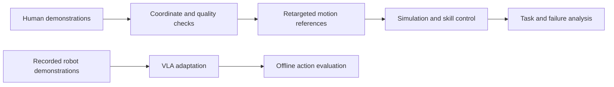

# Xinkai Wu — Robot Learning Portfolio

[中文介绍](README.zh-CN.md)

I am an Automation undergraduate at Southern University of Science and Technology (SUSTech). My interests include robot learning, vision-language-action models, world models and reinforcement learning for manipulation.

This portfolio presents four reproduction and engineering projects: what I worked on, the experiments recorded, and what the results support. It contains original explanations, method diagrams and selected numerical summaries. The development repositories, datasets and model assets are maintained separately.

## Selected projects

| Project | Work presented | Recorded outcome | Read more |
| --- | --- | --- | --- |
| **PI0.5 / FluxVLA reproduction** | Dataset audit, LoRA configuration, training and offline action evaluation | 30,000 training steps; validation action MAE **0.017701** on 10 held-out episodes | [Project](projects/01-vla-reproduction.md) |
| **Glove-to-hand retargeting** | ROS 2 / MuJoCo integration and a self-collision filtering adapter | Implementation and validation protocol; measured runtime results remain pending | [Project](projects/02-glove-retargeting.md) |
| **Contact-constrained retargeting** | Data adapters, coordinate checks, optimization and quality diagnostics | Compared contact accuracy, sampled penetration and motion smoothness; residual quality issues identified | [Project](projects/03-contact-retargeting.md) |
| **Staged dexterous-hand control** | PPO reaching, frozen skill handoff and reference-assisted grasping | **1.473 mm** reaching error in a fixed scene; continuous reach-to-grasp inference evaluated | [Project](projects/04-staged-rl.md) |

The MAE above measures agreement with recorded actions, not physical task success. The RL grasping experiment uses a closing reference and a scripted lift; reference-only control already succeeds.

## How the work connects



These are related learning projects, rather than an already integrated end-to-end system. The VLA model has not been deployed to the dexterous-hand environment; the staged RL policy does not receive runtime tactile feedback.

## Contributions and attribution

My work covers reproduction setup, task configuration, data/interface checking, integration, experiments and analysis. The project pages distinguish these contributions from upstream models, vendor kinematics and existing optimization methods. The work was developed with research guidance and AI-assisted implementation; the descriptions do not claim independent authorship of the upstream systems.

## Evidence and reading guide

- Each project page provides a research question, method, contributions, results and next steps.
- [Curated result summaries](results/README.md) contain selected scalar measurements, units and scope notes.
- [Release notes](docs/release-notes.md) explain what is available here and how to interpret the evidence.
- [Attribution](NOTICE.md) identifies external methods and dependencies.

**Reviewed:** 16 November 2026. Experiment snapshot dates are listed in the project pages. Measurements are transcribed from recorded runs; preparing this portfolio did not rerun the training experiments.

## Checking this repository

With Python 3, run:

```bash
python3 scripts/validate_portfolio.py
```

This checks the public file inventory, local links, result-summary consistency and selected accidental-disclosure patterns. It does not execute the original robot software or certify an experiment's scientific validity.

Original portfolio text and helper code are released under the [MIT License](LICENSE). External models, data and software retain their own terms; they are not included in this repository.
