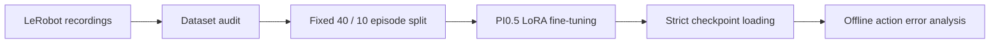

# PI0.5 / FluxVLA Reproduction and Offline Evaluation

[Portfolio](../README.md) · [Result summary](../results/vla-offline-summary.json)

**Scope:** reproduction, task adaptation and offline recorded-data evaluation. **Snapshot:** September 2026.

## Question

Can a PI0.5 policy be adapted to a Tron2 banana pick-and-place demonstration dataset with LoRA, and can the resulting checkpoint produce valid actions for offline comparison?

## Method

The dataset has three camera streams and 16-dimensional robot state/action vectors. The model pads these to 32 dimensions internally; evaluation compares the robot action dimensions with recorded actions. Training uses a 50-step action window.

## My work

- Audited Parquet fields, episode/video completeness, AV1 decoding, action dimensions and gripper semantics.
- Recorded a deterministic episode split: episodes 0–39 for training and 40–49 for validation.
- Prepared task-specific LoRA configuration and diagnosed environment and tokenizer-path failures.
- Completed a smoke run and formal training, checked strict checkpoint loading, and organized offline inference and error analysis.

The model architecture and training baseline come from PI0.5 / OpenPI and FluxVLA; the contribution here is task adaptation and reproduction engineering.

## Recorded results

| Measurement | Value |
| --- | ---: |
| Episodes / frames / videos audited | 50 / 8,438 / 150 |
| Training / validation episodes | 40 / 10 |
| Formal training steps | 30,000 |
| Final training loss | 0.0069022556 |
| Training weighted frame-level action MAE | 0.015256 |
| Validation weighted frame-level action MAE | 0.017701 |
| Predictions containing NaN or Inf | 0 |

The recorded run used one 80 GB-class A100, bf16, batch size 1 and a learning rate of 5e-5. The final checkpoint was the latest training checkpoint, not one selected by validation performance.

MAE measures agreement with recorded same-timestep actions in the evaluation representation. It is not a distance in metres or a robot task-success rate. The fixed ordered split is not a test of new tasks or arbitrary deployment conditions.

## Outcome and next step

The adaptation and offline evaluation chain ran through finite action output. Physical banana pick-and-place success remains untested. A controlled deployment and repeated closed-loop trials would be required before making that claim. The portfolio does not claim bit-for-bit reproduction of every component of the original runtime.

## References

- [FluxVLA-Tron2](https://github.com/clearlab-sustech/FluxVLA-Tron2)
- [FluxVLA](https://github.com/FluxVLA/FluxVLA)
- [OpenPI](https://github.com/Physical-Intelligence/openpi)
- [LeRobot](https://github.com/huggingface/lerobot)

Only the written explanation and selected numerical summary are distributed here; recorded camera streams, robot data and model weights are not included.
