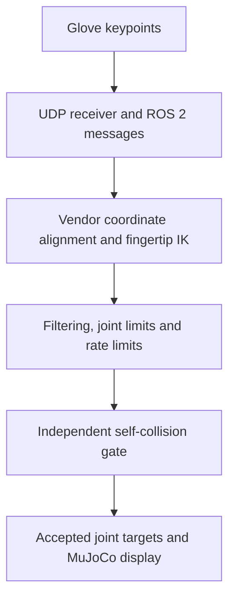

# Glove-to-Revo3 Retargeting and Self-Collision Filtering

[Portfolio](../README.md) · [Implementation status](../results/glove-status.json)

**Scope:** integration and self-collision filtering implementation. **Snapshot:** September 2026.

## Question

How can a glove-driven hand-retargeting chain expose candidate joint targets through ROS 2 while checking joint limits, stale input and self-collision before accepting a target?

## Method

The integration targets Ubuntu 24.04 and ROS 2 Jazzy. The hand model, coordinate mapping and fingertip IK remain external vendor dependencies.

## My work

- Worked on the ROS 2 receiver/message chain and ROS-to-MuJoCo adapter around the existing vendor kinematics.
- Added an independent URDF-based collision checker and a gate after IK, filtering and joint-rate limiting.
- Organized a validation protocol with synthetic input, live-glove checks and separate runtime status reporting.

The gate sweeps the joint-space interval from the previous accepted pose to a candidate. If it encounters an unsafe interval, it refines the boundary by binary search. Invalid input or a checker failure holds the last accepted pose. This checks the configured model and path samples; it is not an exhaustive continuous collision proof.

## What is established

The implementation and protocol are documented. The result-summary file in the reviewed development snapshot is still a template: target-platform build, live-glove timing, collision statistics and dual-hand behavior have no completed quantitative results in that record.

| Item | Evidence status |
| --- | --- |
| Receiver, adapter and self-collision gate | Implementation present in the development project |
| ROS 2 target output | Position-only JointState interface by design |
| Collision penetration tolerance | 0.5 mm configured simulation parameter |
| Target-platform runtime validation | Pending measured results |
| Real-hand closed-loop operation | Not validated |

The 0.5 mm setting is a configured threshold, not a measured performance result or physical safety guarantee. The gate does not establish avoidance of external obstacles or safe contact forces.

## Next step

Record a target-platform build and controlled glove-to-simulation runs, including accepted/limited frames, triggering body pairs, stale-input transitions and loop timing. Validate those separately before any hardware use.

## Attribution

Revo3 kinematics, alignment, IK, robot meshes and the vendor bundle are not my original algorithms and are not distributed here. This page describes the integration and added filtering logic without reproducing vendor implementation or assets.
