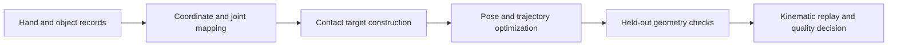

# Contact-Constrained Dexterous-Hand Retargeting

[Portfolio](../README.md) · [Result summary](../results/retargeting-summary.json)

**Scope:** offline kinematic retargeting, data adapters and optimization diagnostics. **Snapshots:** 10–17 October 2026.

## Question

How can human hand trajectories and contact-related observations be converted into robot-hand reference motion while controlling drift, penetration and temporal variation?

## Method and work presented

The work builds on an existing lab retargeting implementation and the contact-preservation idea studied in C2Dex. My work covered input adaptation, pose conventions, joint reordering, fitting support, experiment configuration and diagnostic comparisons. The experiments retain hand-root position/orientation and finger joint motion; they are not restricted to a fixed palm.

## Recorded experiments

### Screwdriver baseline

A 271-frame sequence completed fitting, contact construction and trajectory optimization. Robot-versus-human keypoint mean discrepancy was 12.26 mm; mean contact distance on constrained frames was 5.35 mm. Stable contact labels covered only 6 of 271 frames, while sampled object penetration remained approximately 10.58 mm.

Sparse label coverage matters: frames without contact targets cannot be treated as zero contact error. This is a kinematic baseline with residual quality issues, not a physically verified grasp.

### Bottle-sequence optimization

A 155-frame HORA sequence exposed drift and collision/contact trade-offs. Follow-up work added anchoring and joint second-difference smoothing, then compared parameter retries.

The two retries below start from the same saved trajectory and each run for 300 steps with reset optimizer state. Other configured weights are the same.

| Metric | Learning rate 0.02 | Learning rate 0.002 |
| --- | ---: | ---: |
| Maximum sampled object penetration | 13.76 mm | 3.76 mm |
| Mean contact distance on constrained frames | 11.43 mm | 10.36 mm |
| Joint second-difference RMS | 0.93 degrees | 0.39 degrees |
| Overall quality accepted | No | No |

The lower learning rate meets the configured sampled penetration threshold of 5 mm, but misses the 8 mm contact-distance threshold. Limited mesh probes yielded 3.88 mm penetration for that trial; sampling is not a full-surface collision guarantee. The second-difference metric is a frame-domain smoothness proxy, not physical acceleration in radians per second squared.

### Additional data interface

An OriginData pose-only interface trial processed 119 frames. It remained a quality-rejected interface example: 89 selected frames had invalid global-pose QC, and mapping/calibration still needed verification. It was not accepted as RL training data.

## What I learned

Lowering one geometric error can worsen contact correspondence or unlabelled intervals. I therefore report coverage, geometric checks and quality decisions together instead of presenting a plausible replay as task success. Smoothing demonstrations that continue from a previous solution do not isolate the causal effect of a new loss without a matched control.

## Next step

Improve contact mapping and calibration, then validate the resulting references in a separate dynamics experiment. The planned visual/tactile acquisition pipeline has not been established by these offline trials.

## Attribution

C2Dex-related methods, lab optimization code, MANO, source datasets and Revo3 assets remain separately attributed and are not included. See [NOTICE](../NOTICE.md) for distribution boundaries.
