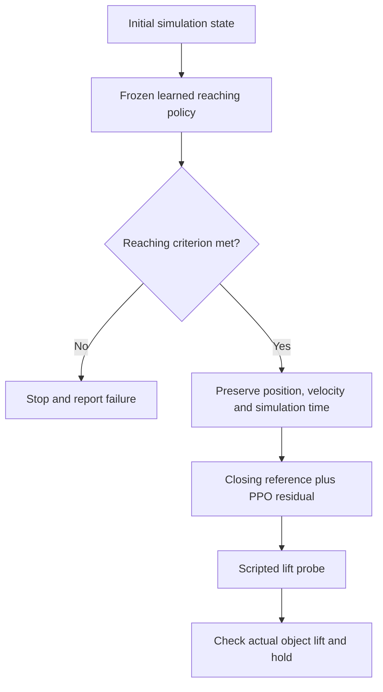

# Staged Dexterous-Hand Control in MuJoCo

[Portfolio](../README.md) · [Result summary](../results/staged-rl-summary.json)

**Scope:** a simulated movable dexterous hand, fixed-scene PPO reaching and reference-assisted grasping. **Snapshots:** 18–20 October 2026.

## Question

Can separately developed reaching and grasping controllers execute consecutively in the same physical simulation state, and which part of the resulting behavior is actually learned?

## Method and my work

My work in the project covered task/control interfaces, reward and observation experiments, PPO training configuration, frozen-policy handoff and evaluation diagnostics. The reaching stage learns translation with a fixed pre-grasp shape. The grasp stage has its own policy and normalization statistics; it does not update the reaching controller.

The simulation uses finite actuation and physical contact. Runtime observations do not include tactile/contact feedback. The closing reference and vertical lift probe are explicit controller components, not actions learned by an upper-level VLA or imitation policy.

## Reaching result

The selected reaching run stopped at 65,536 training steps. From the original fixed hand start it reached a 1.473 mm terminal distance and maintained the required settling condition for 0.3 seconds.

The recorded 100/100 final checks repeat the same physical initial state. They establish repeatability of that case, not performance over 100 independent positions.

## Grasp baseline and training

| Controller | Fixed-scene checks | Recorded lift |
| --- | --- | ---: |
| Initialized PPO plus closing reference | 10/10 | 23.009 mm mean |
| Trained PPO plus closing reference | 100/100 | 23.050 mm mean |
| Closing reference with zero residual | Successful single precheck | 23.309 mm peak |

The stage criterion is at least 20 mm actual object lift and 0.5 seconds of valid hold; the scripted lift target is not itself the measured object motion. The trained-stage replay held for 0.5 seconds. Reference-only and initialized controllers already succeed, so the records do **not establish a meaningful PPO learning benefit**. The peak and mean lift columns also have different aggregation definitions.

The full 50 mm / 2 second task remains incomplete for this learned/reference-assisted pipeline. A separate scripted dynamics demonstration is not counted as a learned full-task result.

## Continuous inference and nearby offsets

One unstitched simulated rollout ran reaching, state-preserving handoff, reference-assisted closing and the lift probe in 7.388 simulated seconds.

| Bottle offset | Reach error | Sequence outcome |
| --- | ---: | --- |
| X +5 mm | 1.768 mm | Completed |
| X −5 mm | 1.677 mm | Completed |
| Y +5 mm | 3.425 mm | Reaching timed out; grasp not attempted |
| Y −5 mm | 1.276 mm | Completed |

These four deterministic probes reveal directional sensitivity. Three completions are not evidence of a general 75% success rate or broad position generalization.

## Next step

Use matched reference-only comparisons, multiple independently trained seeds and randomized held-out conditions to test learning benefit. Extend grasp/lift control only after separating the reference controller's contribution from policy improvement.

## Attribution

Built using [MuJoCo](https://github.com/google-deepmind/mujoco), [Gymnasium](https://github.com/Farama-Foundation/Gymnasium) and [Stable-Baselines3](https://github.com/DLR-RM/stable-baselines3). The robot model and meshes remain external; no trained policies or vendor visuals are redistributed.
